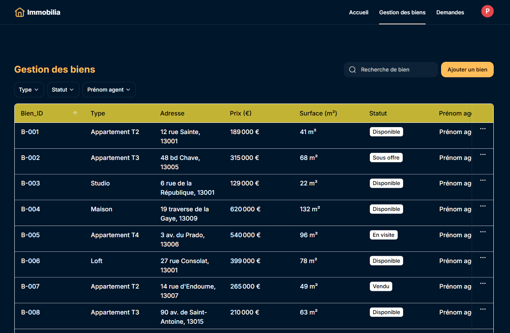

# Immobilia — MVP No-Code pour une agence immobilière
 (images/softr-client.png)
## Présentation

Immobilia est un projet réalisé dans le cadre de ma formation **Chef de projet No-Code & IA**.

L’objectif était de concevoir un MVP pour une agence immobilière indépendante afin de centraliser les biens, gérer les demandes de visite et automatiser certaines tâches répétitives.

## Contexte

L’agence Immobilia gérait principalement ses données avec des fichiers Excel, des emails, WhatsApp et des agendas individuels.

Cela provoquait plusieurs difficultés :

- informations dispersées ;
- mises à jour non synchronisées ;
- risque de perte d’informations ;
- suivi des demandes de visite peu centralisé ;
- tâches répétitives réalisées manuellement.

## Objectifs du MVP

### Côté client

- Consulter les biens disponibles
- Rechercher et filtrer les biens
- Consulter le détail d’un bien
- Envoyer une demande de visite

### Côté agent

- Se connecter à un espace privé
- Consulter et gérer les biens
- Ajouter ou modifier un bien
- Consulter les demandes de visite
- Modifier le statut d’une demande

## Outils utilisés

- **Airtable** : base de données pour les biens, les agents et les visites
- **Softr** : création de l’interface client et de l’espace agent
- **n8n** : automatisation du traitement des demandes de visite
- **Google Calendar** : création automatique des événements de visite
- **Gmail** : envoi des emails de confirmation
- **Figma** : conception de l’arborescence, des user flows et des wireframes

## Architecture

Le fonctionnement principal est le suivant :

**Softr → Airtable → n8n → Google Calendar / Gmail**

Lorsqu’un client envoie une demande de visite, les informations sont enregistrées dans Airtable.

Quand un agent passe le statut de la demande à **Acceptée**, n8n détecte la modification, vérifie le statut, puis :

1. crée automatiquement un événement dans Google Calendar ;
2. envoie un email de confirmation avec Gmail.

Pour la démonstration du projet, n8n est utilisé en local.

## Structure des données

La base Airtable contient trois tables principales :

### Biens

Informations principales des biens immobiliers :

- Bien_ID
- Type
- Adresse
- Prix
- Surface
- Statut
- Description
- Photo
- Agent associé

### Agents

Informations des agents :

- Prénom
- Nom
- Email
- ID agent

### Visites

Informations liées aux demandes de visite :

- Prénom client
- Nom client
- Email client
- Bien demandé
- Date souhaitée
- Statut
- Agent associé

## Sécurité et accès

L’application utilise deux espaces principaux :

- **Espace client public** : consultation des biens et demande de visite
- **Espace agent privé** : gestion des biens et des demandes après connexion

Les fonctions internes sont séparées de l’espace public pour limiter l’accès aux données réservées à l’agence.

## Automatisation n8n

Le workflow principal contient :

**Airtable Trigger → IF → Google Calendar → Gmail**

Le nœud `IF` vérifie que le statut de la demande est égal à **Acceptée** avant de continuer l’automatisation.

## Évolutions futures

Plusieurs fonctionnalités peuvent être ajoutées dans une prochaine version :

- espace direction ;
- tableau de bord global ;
- espace client connecté ;
- historique des visites ;
- gestion des mandats ;
- alertes automatiques ;
- notifications aux agents.

## Plan de migration

Un plan de migration a également été préparé pour centraliser progressivement :

- les contacts clients et prospects ;
- l’historique des visites passées ;
- les mandats signés.

## Aperçus du projet

Les captures du projet sont disponibles dans le dossier `images/` :

- arborescence ;
- user flow ;
- architecture technique ;
- interface client Softr ;
- interface agent Softr ;
- workflow n8n.

## Auteur

**Maan AL ALI**  
Formation : Chef de projet No-Code & IA